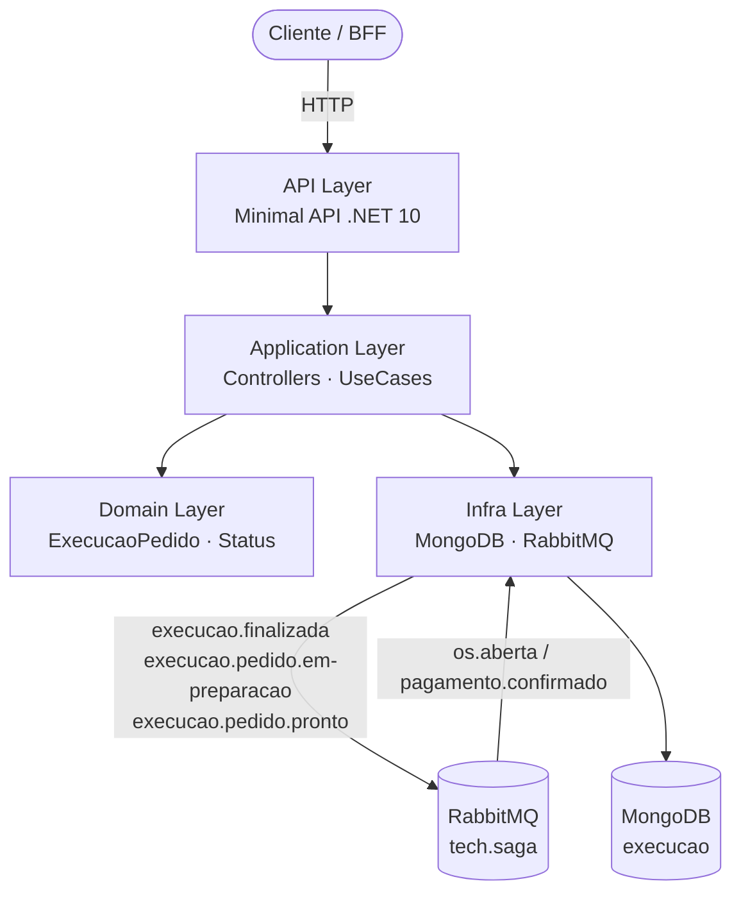

# TechChallenge.Execucao — Microsserviço de Execução

> Fase 4 — FIAP SOAT · Arquitetura de Microsserviços com Saga Pattern

Microsserviço responsável pelo **gerenciamento da fila de execução dos reparos**, criando tarefas de execução quando uma OS é aberta, iniciando o reparo após confirmação do pagamento e comunicando a finalização ao OS Service.

---

## 🔗 Repositórios do TechChallenger

| Serviço | Repositório | Responsabilidade |
|---------|-------------|------------------|
| OS Service | [TechChallenge.OS](https://github.com/TechChallenge01/TechChallenge.OS) | Ciclo de vida das Ordens de Serviço |
| Billing Service | [TechChallenge.Billing](https://github.com/TechChallenge01/TechChallenge.Billing) | Orçamentos e pagamentos (Mercado Pago) |
| Cadastro Service | [TechChallenge.Cadastro](https://github.com/TechChallenge01/TechChallenge.Cadastro) | Clientes, produtos e categorias |
| Estoque Service | [TechChallenge.Estoque](https://github.com/TechChallenge01/TechChallenge.Estoque) | Reserva e liberação de peças |
| **Execução Service** ← *este* | [TechChallenge.Execucao](https://github.com/TechChallenge01/TechChallenge.Execucao) | Fila de execução e reparos |
| BFF | [TechChallenge.bff](https://github.com/TechChallenge01/TechChallenge.bff) | Gateway + Frontend React |

---

## 🏗️ Arquitetura deste repositório



**Camadas (Clean Architecture):**

| Camada | Conteúdo |
|--------|----------|
| `Domain` | `ExecucaoPedido`, status de execução, regras do fluxo de reparo |
| `Shared` | DTOs, interfaces compartilhadas |
| `Application` | Controllers, UseCases (registrar, iniciar, marcar pronto, finalizar) |
| `Infra` | MongoDB, RabbitMQ consumer/publisher |
| `API` | Endpoints Minimal API, Program.cs |

**Deploy:** AWS ECS Fargate · cluster `techchallenge` · região `us-east-1`

---

## 🎯 Objetivo da Fase 4

- Refatorar a aplicação monolítica em microsserviços independentes
- Implementar o **Saga Pattern Coreografado** via RabbitMQ para consistência distribuída
- Gerenciar a fila de execução de forma assíncrona e resiliente
- Pipeline CI/CD independente com testes automatizados e deploy no ECS Fargate
- Monitoramento e observabilidade com **CloudWatch** e **Datadog**

---

## 🔄 Saga Pattern — Papel da Execução

A Execução é o **executor final do fluxo**: recebe a OS quando aberta, aguarda a confirmação de pagamento para iniciar o reparo e notifica o OS Service quando o trabalho está concluído.

**Exchange:** `tech.saga` (Topic, durable) · Broker: RabbitMQ 3.13 no EC2 `100.24.30.116`

### Eventos consumidos por este serviço

| Routing Key | Fila | Ação |
|-------------|------|------|
| `os.aberta` | `execucao.os.aberta` | Cria tarefa de execução (aguarda pagamento) |
| `pagamento.confirmado` | `execucao.pagamento.confirmado` | Inicia preparação do reparo |

### Eventos publicados por este serviço

| Routing Key | Quando | Payload |
|-------------|--------|---------|
| `execucao.pedido.em-preparacao` | Reparo iniciado após pagamento confirmado | `{ ExecucaoId, OrdemServicoId }` |
| `execucao.pedido.pronto` | Reparo concluído, aguarda finalização | `{ ExecucaoId, OrdemServicoId }` |
| `execucao.finalizada` | Execução encerrada com valor final | `{ ExecucaoId, OrdemServicoId, ValorFinal }` |

---

## ⚙️ Pré-requisitos

**Execução local:**
- [.NET 10 SDK](https://dotnet.microsoft.com/download/dotnet/10.0)
- [Docker Desktop](https://www.docker.com/products/docker-desktop/)
- MongoDB 7.0 (via Docker ou Atlas)
- RabbitMQ 3.13 (via Docker)

**Infraestrutura AWS:**
- AWS CLI configurado (`aws configure`)
- Terraform ≥ 1.9
- Acesso ao cluster ECS `techchallenge` em `us-east-1`

---

## 🚀 Como Executar

### Local com Docker Compose

```bash
git clone https://github.com/TechChallenge01/TechChallenge.Execucao.git
cd TechChallenge.Execucao
docker compose up -d
```

Acesse: `http://localhost:5003/scalar` (Scalar API Docs)

### Testes

```bash
dotnet test tests/UnitTests
```

---

## 🔐 Variáveis de Ambiente

| Variável | Descrição | Exemplo |
|----------|-----------|---------|
| `MongoDB__ConnectionString` | URI do MongoDB | `mongodb://localhost:27017` |
| `MongoDB__DatabaseName` | Nome do banco | `execucao` |
| `RabbitMQ__Host` | Host do RabbitMQ | `localhost` |
| `RabbitMQ__Username` | Usuário RabbitMQ | `guest` |
| `RabbitMQ__Password` | Senha RabbitMQ | `guest` |
| `Jwt__Key` | Chave JWT (mín. 32 chars) | — |
| `Jwt__Issuer` | Issuer JWT | `TechChallenger` |
| `Jwt__Audience` | Audience JWT | `TechChallenger` |

---

## 📡 Endpoints da API

Todos os endpoints (exceto `/health`) requerem `Authorization: Bearer <token>`.

| Método | Rota | Descrição |
|--------|------|-----------|
| `GET` | `/health` | Health check |
| `GET` | `/execucoes/{id}` | Buscar execução por ID |
| `GET` | `/execucoes/pedido/{pedidoId}` | Buscar execução por ID da OS |
| `POST` | `/execucoes/{id}/marcar-pronto` | Marcar reparo como pronto |
| `POST` | `/execucoes/{id}/finalizar` | Finalizar execução com valor final |

**Exemplo — Finalizar execução:**
```json
POST /execucoes/3fa85f64-5717-4562-b3fc-2c963f66afa6/finalizar
{
  "valorFinal": 850.00,
  "observacoes": "Substituição de velas e filtro de ar"
}
```

**Ciclo de status da execução:**
```
Registrada → EmPreparacao → Pronta → Finalizada
```

---

## 🏭 Infraestrutura

**Deploy:** AWS ECS Fargate · cluster `techchallenge` · `us-east-1`

Infraestrutura como código em `infra/` (Terraform):

| Arquivo | Recurso |
|---------|---------|
| `ecs.tf` | ECS Service + Task Definition |
| `ecr.tf` | Repositório ECR para a imagem Docker |
| `alb.tf` | Application Load Balancer |
| `cloudwatch.tf` | Log groups `/ecs/execucao-service` |
| `data-sources.tf` | Data sources (VPC, subnets, cluster ECS) |

---

## 📦 Kubernetes

Manifestos em `k8s/`:

| Arquivo | Recurso |
|---------|---------|
| `deployment.yaml` | 2 réplicas, liveness/readiness probes |
| `service.yaml` | ClusterIP porta 80 |
| `hpa.yaml` | Auto-scaling 2–5 pods (70% CPU) |

---

## 🔁 CI/CD

| Workflow | Trigger | Jobs |
|----------|---------|------|
| `deploy.yml` | push `main` (src/) | Build → Push ECR → Deploy ECS |
| `quality.yml` | push/PR `main` | Testes unitários → SonarCloud |
| `infra.yml` | push `main` (infra/) | Terraform plan/apply |
| `k8s-deploy.yml` | manual (`workflow_dispatch`) | Deploy EKS |

---

## 🧪 Testes

```bash
dotnet test tests/UnitTests

# Com cobertura
dotnet test tests/UnitTests --collect:"XPlat Code Coverage" --results-directory coverage/
```

- **Cobertura mínima:** 80% (validada pelo SonarCloud no CI)
- **Relatório:** artefato `coverage-report-execucao` em cada execução do `quality.yml`

---

## 📚 Documentação da API

Scalar UI disponível em:

- **Local:** `http://localhost:5003/scalar`
- **Produção:** via BFF ALB

---

## 📬 Collection Postman

Collection completa (todos os serviços) disponível em:

📂 [`TechChallenge.bff/docs/TechChallenger-Postman-Collection.json`](https://github.com/TechChallenge01/TechChallenge.bff/blob/main/docs/TechChallenger-Postman-Collection.json)

---

## 🗂️ Estrutura do Projeto

```
TechChallenge.Execucao/
├── src/
│   ├── Domain/          # ExecucaoPedido, status, regras de execução
│   ├── Shared/          # DTOs, interfaces compartilhadas
│   ├── Application/     # Controllers, UseCases
│   ├── Infra/           # MongoDB, RabbitMQ consumer/publisher
│   └── API/             # Endpoints, Program.cs
├── tests/
│   └── UnitTests/       # Testes unitários (xUnit)
├── k8s/                 # Manifestos Kubernetes
├── infra/               # Terraform (ECS, ECR, ALB, CloudWatch)
└── .github/workflows/   # CI/CD pipelines
```
